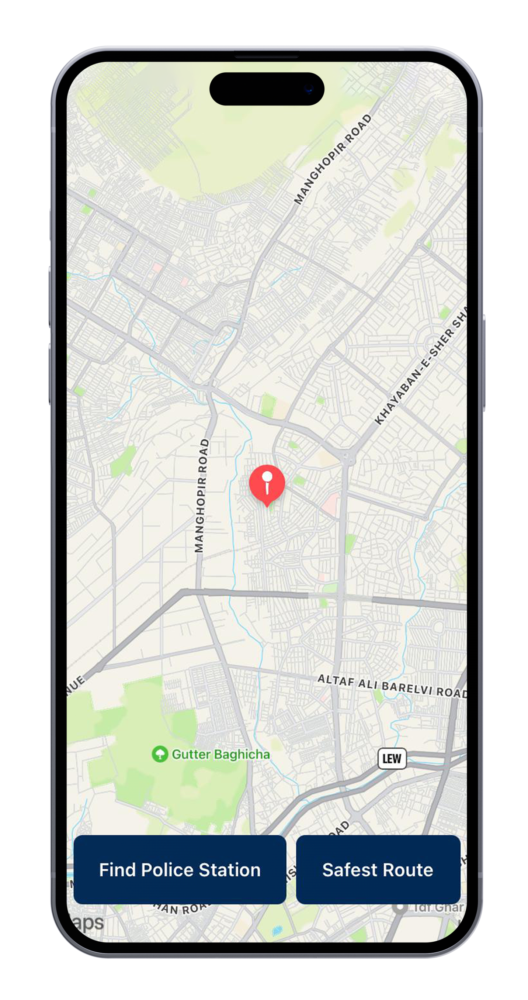
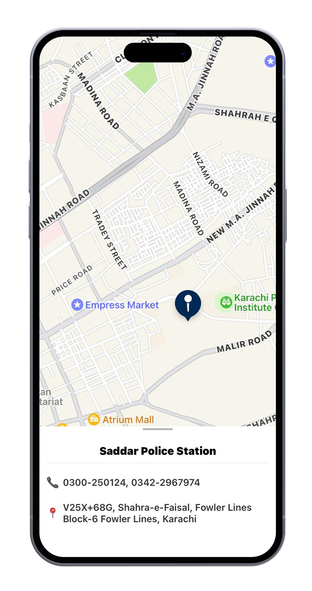
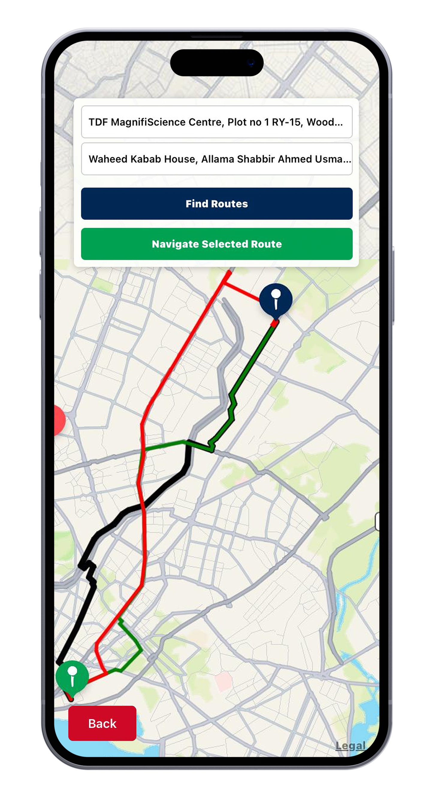
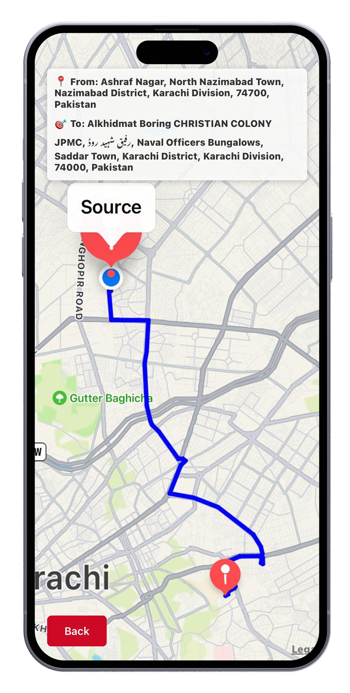
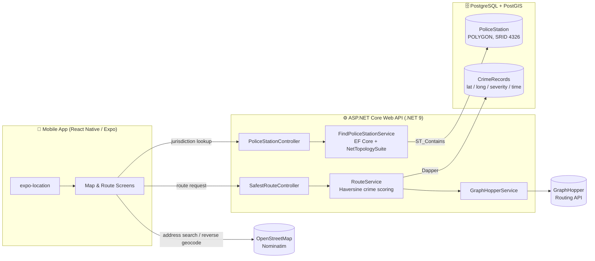
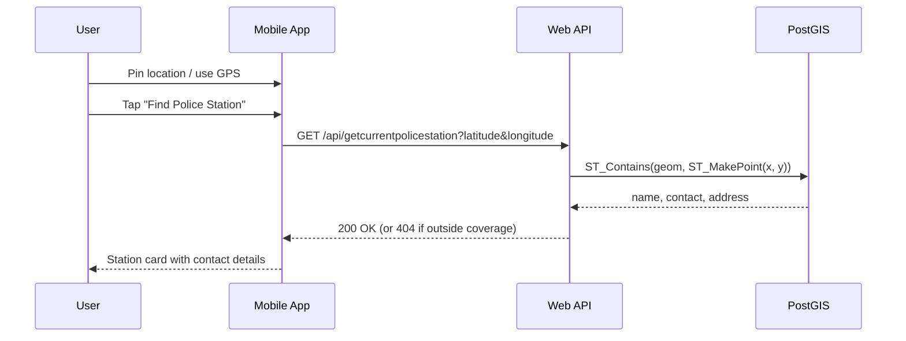

# 🛡️ CrimeShield: Crime-Aware Navigation for Karachi

> A cross-platform mobile app that tells you which police station covers your location and recommends the **safest** route between two points, scored against real historical street-crime data from Karachi's South Zone.


<p align="center">
  
  
  
  
</p>

---

## 📑 Table of Contents

1. [Overview](#1-overview)
2. [Problem Statement](#2-problem-statement)
3. [System Architecture](#3-system-architecture)
4. [Tech Stack](#4-tech-stack)
5. [Data Collection & Spatial Modelling](#5-data-collection--spatial-modelling)
6. [Module 1: Police Jurisdiction Detection](#6-module-1-police-jurisdiction-detection)
7. [Module 2: Safest Route Finder](#7-module-2-safest-route-finder)
8. [Module 3: Live Navigation](#8-module-3-live-navigation)
9. [API Reference](#9-api-reference)
10. [Testing](#10-testing)
11. [Challenges & Solutions](#11-challenges--solutions)
12. [Getting Started](#12-getting-started)
13. [Repository Structure](#13-repository-structure)
14. [Future Improvements](#14-future-improvements)
15. [Team & Acknowledgements](#15-team--acknowledgements)

---

## 1. Overview

CrimeShield is a location-based safety app built as a Final Year Project (BS Computer Science, FAST-NUCES Karachi, 2025). It combines three things:

- **Geospatial jurisdiction lookup:** drop a pin or use GPS, and the app returns the responsible police station with its contact number and address.
- **Crime-weighted route scoring:** for any trip, the app fetches up to three alternative routes and ranks them by how close they pass to recent crime hotspots.
- **Turn-by-turn tracking:** follow the chosen route on a live map with your position updating in real time.

The pilot covers **Karachi South Zone: 39 police station jurisdictions** and **12,500+ street-crime records from 2024–2025**.

## 2. Problem Statement

Karachi is a dense city with persistent street-crime concerns. Most citizens:

- don't know which police station has jurisdiction over where they are standing, which slows down reporting in an emergency, and
- have no data-driven way to know whether the route their map app suggests passes through crime-prone areas.

Standard navigation apps optimise for **time and distance**. CrimeShield adds a third dimension: **safety**.

**Requirements**

| Type | Requirement |
|---|---|
| Functional | Detect the police jurisdiction from GPS coordinates |
| Functional | Show station name, contact, and address |
| Functional | Find and compare multiple routes between two points by crime exposure |
| Functional | Navigate along the selected route with live location |
| Non-functional | Location queries answer in under 2 seconds |
| Non-functional | No user location history is stored on the server |
| Non-functional | Responsive UI on Android and iOS |

## 3. System Architecture

CrimeShield follows a three-tier architecture: a thin mobile client, a stateless REST API holding the business logic, and a spatial database.



**Design decisions**

- **PostGIS for jurisdictions:** station boundaries are stored as real `GEOMETRY(POLYGON, 4326)` shapes, so "which station covers this point?" becomes a single indexed `ST_Contains` query instead of application-side polygon math.
- **EF Core and Dapper side by side:** EF Core with NetTopologySuite handles the spatial entity; Dapper handles the high-volume, read-only crime record query where raw SQL is simpler and faster.
- **Routing delegated to GraphHopper:** rather than hosting a road graph, the API requests alternative routes from GraphHopper and applies its own safety scoring on top.
- **Stateless API:** coordinates arrive per request and nothing about the user is persisted, which satisfies the privacy requirement by design.

## 4. Tech Stack

| Layer | Technology |
|---|---|
| Mobile | React Native 0.79, Expo 53, react-native-maps, React Navigation, expo-location, Axios |
| Backend | ASP.NET Core Web API (.NET 9), Swagger / OpenAPI |
| Data access | Entity Framework Core + Npgsql + NetTopologySuite, Dapper |
| Database | PostgreSQL with the PostGIS extension |
| Routing | GraphHopper Routing API (`alternative_route`, up to 3 paths) |
| Geocoding | OpenStreetMap Nominatim (search bounded to Karachi, reverse geocoding) |
| Boundary tooling | Leaflet + Leaflet.draw (custom polygon-drawing page) |

## 5. Data Collection & Spatial Modelling

### 5.1 Police jurisdiction boundaries

Official jurisdiction boundaries were not available in a GIS format, so they were digitised by hand:

1. Boundaries were gathered from Sindh Police (South Zone) references and field research.
2. A small Leaflet tool ([`database/tools/boundary-drawer.html`](database/tools/boundary-drawer.html)) let the team trace each jurisdiction on an OpenStreetMap base layer and export the vertex coordinates.
3. Each shape was inserted into PostGIS as a closed polygon in WGS 84 (SRID 4326).

```sql
CREATE TABLE PoliceStation (
    id      SERIAL PRIMARY KEY,
    name    VARCHAR(100),
    contact VARCHAR(100),
    address VARCHAR(250),
    geom    GEOMETRY(POLYGON, 4326)
);

INSERT INTO PoliceStation (name, contact, address, geom)
VALUES ('Nabi Bux Police Station', '...', '...',
        ST_GeomFromText('POLYGON((67.020173 24.862305, 67.018564 24.864885, ... , 67.020173 24.862305))', 4326));
```

**Coverage:** 39 stations, including Saddar, Clifton, Boat Basin, Darakhshan, Defence, Artillery Maidan, Mithadar, Kharadar, Docks, Baldia, and Site-A/B. Full scripts are in [`database/`](database/).

### 5.2 Crime records

Street-crime data for 2024–2025 (mobile snatching, cash snatching, motorcycle theft, and similar) was sourced from Sindh Police South Zone records: roughly **12,500 incidents**, each with crime type, police station, district, hotspot description, date, and time.

Hotspot descriptions were converted to coordinates and each record was assigned a severity level before loading into:

```sql
CREATE TABLE CrimeRecords (
    CrimeID             SERIAL PRIMARY KEY,
    CrimeType           VARCHAR(100) NOT NULL,
    CrimeSeverity       VARCHAR(50),        -- High / Medium / Low
    Latitude            FLOAT NOT NULL,
    Longitude           FLOAT NOT NULL,
    LocationDescription VARCHAR(255),
    DateTime            TIMESTAMP,
    ReportedBy          VARCHAR(255),
    CrimeStatus         VARCHAR(50),
    Radius              INT
);
```

> ℹ️ The raw police dataset is **not** included in this repository. See [Section 12](#12-getting-started) for loading your own data.

## 6. Module 1: Police Jurisdiction Detection

**Flow:** User opens the map → uses current GPS location or long-presses to pin a point → taps **Find Police Station** → a bottom sheet slides up with the station's name, phone number, and address.



**Core query** (`FindPoliceStationService.cs`):

```sql
SELECT name, contact, address
FROM   policestation
WHERE  ST_Contains(geom, ST_SetSRID(ST_MakePoint(:x, :y), 4326));
```

Points outside the 39 mapped polygons return a `404` with *"No police station found for the given coordinates"*, which the app shows to the user.

## 7. Module 2: Safest Route Finder

This is the core of the project.

### 7.1 Getting candidate routes

The user picks a source and destination by typing (Nominatim autocomplete, bounded to Karachi's bounding box) or by tapping the map (reverse geocoding). The API then asks GraphHopper for up to **three alternative routes**:

```
GET https://graphhopper.com/api/1/route
    ?point={srcLat},{srcLng}&point={dstLat},{dstLng}
    &vehicle=car&algorithm=alternative_route
    &alternative_route.max_paths=3&points_encoded=false
```

### 7.2 Scoring each route

Every route is a list of coordinates. `RouteService.GetSafeRoutes` scores each one:

1. **Time-aware filtering:** only crimes that historically happened within **±1 hour of the current time of day** (Pakistan Standard Time) are considered. A route that's risky at 11 PM may be fine at 11 AM.
2. **Proximity check:** for every point on the route, the **Haversine great-circle distance** to each relevant crime is computed.
3. **Severity weighting:** any crime within **1 km** of a route point adds to the score by severity.

| Severity | Weight |
|---|---|
| High | 10 |
| Medium | 5 |
| Low | 1 |

```
RouteScore = Σ (route points) Σ (crimes within 1 km, same time window) SeverityWeight(crime)
```

```csharp
double distance = CalculateDistance(pointLat, pointLong, crime.Latitude, crime.Longitude);
if (distance < 1.0)
    crimeScore += GetCrimeSeverityScore(crime);   // High=10, Medium=5, Low=1
```

### 7.3 Presenting the result

The app sorts the routes by score and colour-codes them on the map:

| Colour | Meaning |
|---|---|
| 🔵 Blue | Lowest crime score (safest) |
| 🟢 Green | Medium risk |
| 🔴 Red | Highest crime score |

The user can tap any route to select it (it turns black) and then press **Navigate Selected Route**.

<p align="center"></p>

## 8. Module 3: Live Navigation

After selecting a route, the navigation screen:

- draws the chosen route in its safety colour,
- shows a header with the full source and destination addresses,
- subscribes to `expo-location` updates and re-centres the map on the user as they move.

<p align="center"></p>

## 9. API Reference

Swagger UI is available at `/swagger` when the API is running.

| Method | Endpoint | Description |
|---|---|---|
| `GET` | `/api/getcurrentpolicestation?latitude=&longitude=` | Police station covering the given point |
| `GET` | `/api/SafestRoute/paths?sourceLat=&sourceLong=&destLat=&destLong=` | Raw GraphHopper alternative routes (GeoJSON coordinates) |
| `GET` | `/api/SafestRoute/paths-scores?sourceLat=&sourceLong=&destLat=&destLong=` | Crime score per route, in the same order as `/paths` |
| `GET` | `/api/DbTest/test-connection` | Health check returning the PostgreSQL version |

**Sample response: jurisdiction lookup**

```json
{
  "currentLatitude": 24.8524,
  "currentLongitude": 67.0308,
  "policeStationName": "Artillery Maidan Police Station",
  "contactNumber": "...",
  "address": "..."
}
```

**Sample response: route scores** (illustrative values)

```json
[ 1840.0, 2675.0, 4120.0 ]
```

## 10. Testing

| Test case | Input | Expected | Result |
|---|---|---|---|
| Location near DIG Office | 24.8524, 67.0308 | Artillery Maidan Police Station | ✅ Pass |
| Location in Boulton Market | 24.8474, 66.9985 | Mithadar Police Station | ✅ Pass |
| Route Saddar → Mithadar | Source / destination | Three routes: blue, green, red | ✅ Pass |
| Route across a high-crime zone | Empress Market → Lyari | Three routes: blue, green, red | ✅ Pass |
| Location outside mapped area | Coordinates outside South Zone | "No police station found" | ✅ Pass |

API endpoints were exercised through Swagger UI during development.

## 11. Challenges & Solutions

| Challenge | Solution |
|---|---|
| **No GIS boundary data existed** for police jurisdictions | Built a Leaflet-based drawing tool to trace each jurisdiction on OpenStreetMap and export polygon vertices straight into PostGIS insert scripts |
| **Crime data only had text hotspot descriptions** (e.g. "Opp. Shaheen Complex") rather than coordinates | Converted hotspot descriptions to latitude/longitude and normalised crime types into severity levels before import |
| **Coordinate order confusion:** PostGIS uses `(x=longitude, y=latitude)`, GraphHopper returns `[lng, lat]`, react-native-maps expects `{latitude, longitude}` | Standardised on storing polygons as `lng lat` in SRID 4326 and mapped GraphHopper's `[lon, lat]` arrays explicitly on the client |
| **"Safest" is time-dependent:** a street can be fine at noon and risky at midnight | Added a ±1 hour time-of-day window so only historically relevant crimes affect the score |
| **Getting meaningful route choices**, not just the fastest path | Used GraphHopper's `alternative_route` algorithm to request up to three genuinely different paths |

## 12. Getting Started

### Prerequisites

- .NET 9 SDK
- Node.js 18+ and the Expo CLI (or the Expo Go app on your phone)
- PostgreSQL 14+ with PostGIS
- A free [GraphHopper API key](https://www.graphhopper.com/)

### 12.1 Database

```sql
CREATE EXTENSION IF NOT EXISTS postgis;
```

```bash
psql -d crimeshield -f database/01_create_police_station_table.sql
psql -d crimeshield -f database/02_insert_police_station_boundaries.sql
psql -d crimeshield -f database/03_create_crime_records_table.sql
# then load your own crime records into CrimeRecords
```

### 12.2 Backend API

Fill in `api/CrimeShieldApi/appsettings.json` (or use `dotnet user-secrets` / environment variables):

```json
"ConnectionStrings": {
  "DefaultConnection": "Host=<DB_HOST>;Port=5432;Database=<DB_NAME>;Username=<DB_USER>;Password=<DB_PASSWORD>;"
},
"GraphHopper": {
  "ApiKey": "<GRAPHHOPPER_API_KEY>"
}
```

```bash
cd api/CrimeShieldApi
dotnet restore
dotnet run
# Swagger: https://localhost:7282/swagger
```

### 12.3 Mobile app

Set your API URL in `mobile-app/config.js`:

```js
export const API_BASE_URL = "https://<YOUR_API_HOST>";
```

```bash
cd mobile-app
npm install
npx expo start
```

Scan the QR code with Expo Go, or press `a` / `i` for an emulator.

## 13. Repository Structure

```
CrimeShield/
├── api/
│   ├── CrimeShieldApi.sln
│   └── CrimeShieldApi/
│       ├── Controllers/        # PoliceStation, SafestRoute, DbTest
│       ├── Services/           # RouteService, GraphHopperService, FindPoliceStationService
│       ├── Data/               # EF Core + Dapper contexts
│       ├── Models/ DTOs/
│       ├── Program.cs
│       └── appsettings.json    # placeholders only
├── mobile-app/
│   ├── screens/                # Splash, Map, Route, Navigation
│   ├── assets/
│   ├── config.js               # API base URL
│   └── App.js
├── database/
│   ├── 01_create_police_station_table.sql
│   ├── 02_insert_police_station_boundaries.sql
│   ├── 03_create_crime_records_table.sql
│   └── tools/boundary-drawer.html
└── docs/screenshots/
```

## 14. Future Improvements

- **Push scoring into PostGIS:** replace the in-memory point × crime loop with `ST_DWithin` on a `LINESTRING` built from the route, backed by a GiST index, so scoring scales to city-wide data.
- **Normalise scores by route length** so a longer route isn't penalised simply for having more sample points.
- **Handle time windows that cross midnight** (e.g. 23:30 ± 1 h).
- **Recency decay:** weight recent incidents more heavily than older ones.
- **Expand coverage** from South Zone to all of Karachi, then other cities.
- **Crime heatmap layer** on the map, and a jurisdiction boundary overlay.
- **Authentication and rate limiting** on the API, plus a restricted CORS policy.
- **Containerise** the API and database with Docker Compose for one-command setup.

## 15. Team & Acknowledgements

Final Year Project **F24-190**, FAST School of Computing, National University of Computer and Emerging Sciences (NUCES), Karachi Campus. Submitted May 2025.

**Supervisor:** Miss Abeer Gauher

**Team**
- Muhammad Hussain Malik (Project Manager)
- Muhammad Nohail
- Hasnain Raza


**Data sources:** Sindh Police (South Zone) for jurisdiction references and historical crime data; OpenStreetMap contributors for base maps and geocoding; GraphHopper for routing.
